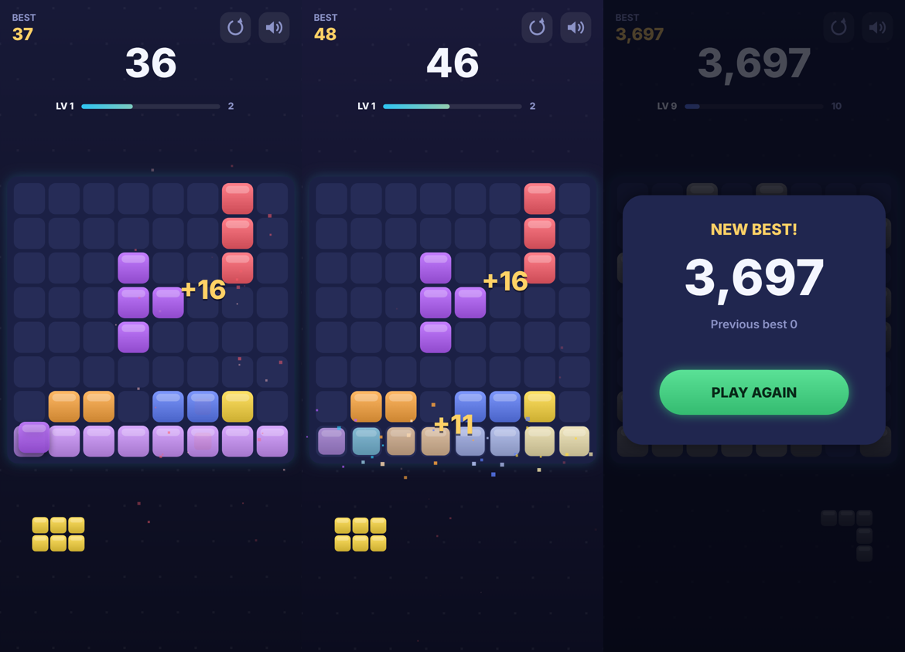

# Lumina Blocks

A calm, endlessly replayable block puzzle. Drag three pieces onto an 8×8 board,
fill a row or column to clear it, chain clears into combos, climb levels and
chase your best score. One gesture, no timers, no menus.



Built with **TypeScript** and the HTML5 canvas, with **zero runtime
dependencies** (the whole game is a ~33 kB script). It runs in any modern
browser, installs as a PWA, works offline, and packages for Google Play with
Capacitor — see [docs/PLAY_STORE.md](docs/PLAY_STORE.md).

> The project was first requested in C#/.NET. It was moved to TypeScript for
> two reasons: the build environment had no .NET SDK, so C# code could not
> have been compiled or tested there; and a browser game reaches Android, iOS,
> desktop and the web from one codebase. The architecture below (domain model,
> strategies, ports and adapters) carries over directly to C# if a .NET port
> is ever wanted.

## Play it

```bash
npm install
npm start          # type-checks, bundles, serves web/ on a local port
```

Other commands:

| Command              | What it does                                                    |
| -------------------- | --------------------------------------------------------------- |
| `npm test`           | Runs the unit tests for the game rules                          |
| `npm run build`      | Type-checks and bundles `src/` into `web/game.js`               |
| `npm run standalone` | Builds `dist/LuminaBlocks.html`, a single double-clickable file |

Controls: drag with mouse or finger. `R` restart, `M` mute, `Space` play again.

## How the game works

- The tray holds three pieces. Place all three and three more are dealt.
- A full row or column clears. Clearing several at once pays much more
  (10 / 30 / 60 / 100 points for 1–4 lines).
- Consecutive clears build a **combo** that multiplies line points (up to ×8).
  The combo survives two placements without a clear and resets on the third.
- Emptying the whole board is a **perfect clear**: +200.
- Every 100, 200, 300… points is a new **level**; higher levels deal more big
  pieces and fewer rescues.
- The game ends when none of the remaining pieces fits. Progress is saved
  automatically, so closing the app mid-game loses nothing.

## Architecture

Dependencies point inwards only: `ui` and `infrastructure` depend on `core`;
`core` depends on nothing, not even the browser.

```
src/
  core/                    Pure game logic. No DOM, no storage, no time.
    domain/                Board, Shape, ShapeLibrary, Piece, GridPoint
    scoring/               ScoringPolicy (strategy) + ComboScoringPolicy
    generation/            PieceGenerator (strategy) + FairPieceGenerator, RandomSource
    game/                  GameSession (aggregate root), LevelProgression, GameState
    persistence/           PlayerProfile + the ProfileStore and Clock ports
    services/              GameService: the one facade the UI talks to
    util/                  Signal (typed observer)
  infrastructure/          Adapters for the ports: localStorage, system clock
  ui/                      Canvas presentation
    gameView.ts            Controller: input -> GameService, events -> feedback
    renderer.ts            Draws a frame; never mutates anything
    layout.ts              Pure geometry and hit-testing
    effects.ts             Particles, floating text, flashes, shake
    audio.ts               FeedbackPlayer port + WebAudio synthesiser, haptics
    theme.ts               Palette and colour maths
  main.ts                  Composition root: wires concrete classes together
tests/                     Unit tests for core + the storage adapter
web/                       Static shell: index.html, manifest, service worker, icons
```

Design decisions worth knowing:

- **Rules are testable without a browser.** `Board`, `GameSession` and
  `GameService` are exercised by `npm test`, including 20 full simulated games
  and a check that the generator never deals an unplayable tray.
- **Strategies for everything tunable.** Scoring, piece dealing, level curve
  and randomness are interfaces injected in `main.ts`; a new game mode is a
  new implementation, not an edit to `GameSession`.
- **Ports and adapters at the edges.** Storage, the clock and sound sit behind
  interfaces, so swapping localStorage for cloud saves, or adding ads or
  analytics, touches `infrastructure/` and `main.ts` only.
- **Saved data is untrusted.** A corrupt or outdated save is discarded rather
  than crashing; blocked storage degrades to "not saved", never "not playable".
- **The UI holds no game truth.** `ViewState` is animation state only (the
  counting score, the drag, the fade); the renderer reads and never writes.

## Engagement design

What keeps people playing is designed deliberately, and each item is a named
piece of code you can tune:

| Principle                         | In the game                                                                                                              | Where                          |
| --------------------------------- | ------------------------------------------------------------------------------------------------------------------------ | ------------------------------ |
| Focus through colour              | Deep, cool, low-contrast backdrop; the blocks are the only saturated things on screen; the board carries a soft glow       | `ui/theme.ts`, `renderer.ts`   |
| Colour with stable meaning        | Gold appears only for reward (points, best score); red only for danger and confirmation                                    | `ui/theme.ts`                  |
| Calm pattern, no distraction      | A slow, regular dot lattice drifts behind the board: alive, but predictable enough to ignore                               | `renderer.drawBackground`      |
| Instant feedback                  | Every placement pops and thuds; every clear flashes, bursts, shakes and plays a rising chime; vibration on phones          | `gameView.onPlaced`, `effects` |
| Anticipation                      | While dragging, lines that will clear light up before you let go                                                           | `Board.previewClear`           |
| Escalating reward                 | Combos climb a pentatonic scale, the backdrop warms up, praise text grows                                                  | `audio.ts`, `ViewState.heat`   |
| A goal that is always near        | Level bar under the score; early levels need few points                                                                    | `LevelProgression`             |
| A goal that is always far         | Best score is always visible; game over says "Only 40 from your best"                                                      | `renderer.drawGameOver`        |
| Flow: challenge tracks skill      | Big pieces on an open board, smaller ones when crowded, harder trays at higher levels                                      | `FairPieceGenerator`           |
| Fair losses                       | A tray always contains a playable piece, so a loss reads as "my mistake", which is what makes people retry                 | `FairPieceGenerator`           |
| Zero-friction retry               | One tap or `Space` from game over to a fresh board; no menus, no loading                                                   | `gameView.ts`                  |
| Wordless onboarding               | On first run a ghost piece glides from tray to board until the player copies it                                            | `renderer.drawOnboarding`      |
| Forgiving input                   | Pieces snap to the nearest legal spot within a cell; on touch the piece floats above the finger                            | `gameView.updateDragTarget`    |
| Habit                             | Day streak, shown on the game-over card                                                                                    | `GameService.registerVisit`    |

Deliberately left out: fake countdown timers, guilt notifications, pay-to-continue
pressure and loot boxes. The aim is a game people return to because it feels
good, not because it nags them. The game also honours the system "reduce
motion" setting and has a one-tap mute.

## Status

Verified in this repository: type-check, 16 unit tests, and a scripted
headless-Chromium session (mouse and touch) that played full games to game
over, reloaded mid-game to confirm resume, and exercised restart and mute.

Not yet done:

- The Android build itself (see [docs/PLAY_STORE.md](docs/PLAY_STORE.md)).
- Testing on physical phones and in Safari/iOS.
- Monetisation, leaderboards and analytics: none are included.
- The name "Lumina Blocks" and the bundle id are placeholders; check them
  against existing Play Store titles and trademarks before publishing.
